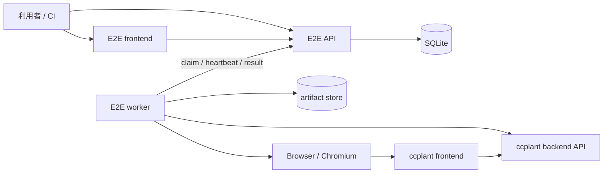

# E2E 実行基盤設計

## 目的

ルートの `e2e/` 以下に、ccplant の実サービスをブラックボックスで検証する独立した E2E
実行基盤を置く。利用者は Web UI または API からシナリオを選択して実行し、
進捗、ログ、失敗理由、スクリーンショットなどの成果物を確認できる。

既存の `frontend/e2e` は、モックを使ったフロントエンド単体の Playwright テストとして残す。
新しい基盤は backend、frontend、Agent session をまたぐ実環境の検証を担当する。

## 設計方針

- API E2E は Go 標準の `testing`、frontend E2E は Playwright を使う。共通シナリオ SDK は作らない。
- E2E API と worker は Go、操作 UI と frontend scenario は TypeScript とする。
- API と worker を分離し、ローカル、CI、将来の共有検証環境で同じプロトコルを使う。
- worker は登録済みシナリオだけを実行する。API から任意のコマンドや Go コードを渡せないようにする。
- シナリオは外部から見える HTTP/SSE/ブラウザ操作を使い、backend や frontend の内部 package を import しない。
- 最初は SQLite とローカルファイルで完結させ、インターフェースを保ったまま外部 DB と object storage に移行できるようにする。
- リトライは run 全体ではなく明示的に安全な step に限定する。失敗を隠す自動リトライはしない。

## 全体構成



E2E API は制御プレーン、worker は実行プレーンである。ccplant 本体の backend と frontend に
E2E 専用の endpoint は追加しない。

## ディレクトリ構成

```text
e2e/
├── README.md
├── go.mod
├── compose.yaml                 # SUT + API + worker + E2E frontend + Chromium
├── Makefile
├── cmd/
│   ├── api/main.go
│   └── worker/main.go
├── internal/
│   ├── api/                     # HTTP handler、認証、SSE
│   ├── store/                   # run、event、lease、artifact metadata
│   ├── worker/                  # claim loop、実行、heartbeat、cancel
│   │   └── executor/            # go-test / playwright adapter
│   └── artifact/                # filesystem 実装。将来 S3 実装を追加
├── pkg/
│   └── apitest/                 # API URL、認証、polling だけの薄い test helper
├── scenarios/
│   ├── catalog.yaml             # 実行可能な scenario の allowlist と metadata
│   ├── api/
│   │   ├── smoke_test.go
│   │   └── session_test.go
│   └── frontend/
│       ├── playwright.config.ts
│       ├── package.json
│       └── session.spec.ts
├── frontend/                    # E2E 操作用の小さな React/Vite アプリ
│   ├── package.json
│   └── src/
├── migrations/
├── testdata/
├── Dockerfile.api
├── Dockerfile.worker
└── .env.example
```

`e2e` は独立した Go module とする。アプリ本体の module にテスト用依存を混ぜず、API scenario を
通常の `go test` として単独実行できるようにするためである。Go のバージョンは `backend/go.mod` と揃える。

## コンポーネント

### E2E API

責務は次に限定する。

- シナリオ一覧の提供
- run の作成、参照、キャンセル
- worker への run の lease
- event、step result、artifact metadata の保存
- UI 向けの SSE 配信

API 自身はシナリオを実行しない。再起動しても queued/running run を復元できるよう、状態はすべて
store に置く。

### Worker

worker は起動時に `worker_id`、build revision、登録済み scenario catalog、capability を API に
通知する。空きがある間だけ run を claim し、各 run を個別プロセスとして実行する。run の `kind` に
応じて `go-test` または `playwright` executor を選択する。

初期値は worker 1 台につき同時実行数 1 とする。ブラウザ状態やテスト対象データの競合を避け、
並列安全性が確認できたシナリオだけ `concurrency_key` を分けて並列化する。

lease の既定値は 30 秒、heartbeat は 10 秒間隔とする。lease が失効した run はすぐに再実行せず
`infra_error` にする。副作用済みか判断できないためである。利用者が明示的に再実行する。

worker は SIGTERM 時に新規 claim を停止し、実行中 run を grace period 内で終了する。キャンセル時は
子プロセスへ SIGTERM を送り、猶予後に終了したうえで artifact upload を試みる。

### E2E frontend

最初の UI は以下の 3 画面だけにする。

- Run list: category 別の分類、状態、日本語description、対象環境、開始時刻、所要時間
- New run: category で絞り込んだシナリオ、許可された parameter、対象 environment の選択
- Run detail: step timeline、追従ログ、artifact、cancel/re-run

UI は API の OpenAPI から生成した client を利用する。run detail の更新は SSE、変更操作は REST とし、
WebSocket は導入しない。

## シナリオ方式

API と frontend は、目的に合う既存のテストランナーをそのまま使う。worker はプロセス管理と結果の
正規化だけを担当し、独自の assertion、step、browser abstraction は持たない。

| 種別 | 定義言語 | runner | assertion / step | 主な artifact |
| --- | --- | --- | --- | --- |
| API | Go | `go test` | `testing.T`、`t.Run` | `test2json`、任意のresponse dump |
| frontend | TypeScript | Playwright | `test.step`、`expect` | trace、screenshot、video、DOM |

### API E2E

API scenario は通常の `_test.go` として書く。標準ライブラリの `net/http` と `testing` を基本にし、
追加する helper は認証 header、JSON encode/decode、SSE、eventual polling など ccplant 固有の重複だけに
限定する。HTTP client libraryや独自DSLは導入しない。

```go
func TestSessionCreateAndChat(t *testing.T) {
    client := apitest.NewClient(t, apitest.ConfigFromEnv())

    session := client.CreateSession(t, apitest.CreateSessionRequest{
        Repository: os.Getenv("E2E_REPOSITORY"),
    })
    t.Cleanup(func() { client.DeleteSession(context.Background(), session.ID) })

    t.Run("session becomes ready", func(t *testing.T) {
        client.EventuallyStatus(t, session.ID, "ready", 90*time.Second)
    })
    t.Run("message receives a reply", func(t *testing.T) {
        reply := client.SendAndWait(t, session.ID, "reply with pong")
        assert.Equal(t, "pong", reply.Text)
    })
}
```

worker image の build 時に `go test -c` で test binary を作り、実行時には Go source の compile や
dependency download を行わない。scenario ID は catalog に記載した package と test name にだけ解決する。

```text
go tool test2json -t /opt/e2e/api.test \
  -test.v -test.run '^TestSessionCreateAndChat$' -test.timeout 3m
```

worker は `test2json` の `run/pass/fail/output` を共通 run event に変換する。`t.Run` の subtest が UI 上の
step になる。開発者は同じ test を `go test -v ./scenarios/api -run TestSessionCreateAndChat` で直接実行できる。

### Frontend E2E

frontend scenario は Playwright Test を使う。auto-wait、role selector、trace viewer、screenshot/video など
ブラウザテストに必要な機能が揃っているため、Go 用browser wrapperは作らない。既存の
`frontend/e2e` はモック主体、`e2e/scenarios/frontend` は実backendを使う、という境界にする。

worker は catalog の scenario ID を Playwright tag（例: `@session-create`）へ安全に解決し、固定引数で
`playwright test --grep` を実行する。JSON reporter の結果を共通 run event に変換し、Playwright が出力した
artifact をそのまま収集する。

### Scenario catalog

`catalog.yaml` は実行可能な scenario の allowlist であり、任意の command line は持たせない。
`id` はAPI・CLI・ログで使う変更しない識別子、`description` はUIに表示する日本語タイトルとする。
category も同様に安定した `id` と日本語の `description` を分離する。

```yaml
categories:
  - id: smoke
    description: スモークテスト
  - id: session
    description: セッション

scenarios:
  - id: api.session.create-and-chat
    category: session
    description: APIでセッションを作成してチャットできる
    kind: go-test
    test: TestSessionCreateAndChat
    timeout: 3m
    capabilities: [agent-credential]
  - id: frontend.session.create
    category: session
    description: 画面からセッションを作成できる
    kind: playwright
    tag: "@session-create"
    timeout: 3m
    capabilities: [chromium, agent-credential]
```

CI で、catalog の Go test name が `go test -list` に存在すること、Playwright tag が一意に存在すること、
ID・category・日本語description・timeout・parameter schema が妥当であることを検証する。未定義category、
空のdescription、重複IDはエラーにする。scenario の列挙と実行対象の決定は catalog だけを正とし、API
request から package、test name、tag、コマンド引数を直接指定させない。

初期categoryは `smoke`、`auth`、`session`、`settings`、`integration` とする。シナリオ数が増えるまでは
階層化せず、1 scenario は必ず1 categoryに所属させる。横断的な属性はcategoryを増やさず、任意の
`tags`（例: `critical`、`requires-github`）で表現する。

## API 契約

公開 API は `/api/v1`、worker API は `/internal/v1` に分ける。

| Method | Path | 用途 |
| --- | --- | --- |
| `GET` | `/api/v1/scenarios` | category、日本語description、parameter schemaを含むシナリオ一覧 |
| `POST` | `/api/v1/runs` | run を queued で作成 |
| `GET` | `/api/v1/runs` | run 一覧。`category`、`scenario_id`、`status`で絞り込み |
| `GET` | `/api/v1/runs/{id}` | run、step、artifact の snapshot |
| `POST` | `/api/v1/runs/{id}/cancel` | キャンセル要求。冪等 |
| `POST` | `/api/v1/runs/{id}/rerun` | 元の入力から新しい run を作成 |
| `GET` | `/api/v1/runs/{id}/events` | `id:` 付き SSE。`Last-Event-ID` 対応 |
| `GET` | `/api/v1/runs/{id}/artifacts/{artifact_id}` | artifact download |
| `POST` | `/internal/v1/workers/register` | worker manifest 登録 |
| `POST` | `/internal/v1/runs/claim` | capability に合う run を lease |
| `POST` | `/internal/v1/runs/{id}/heartbeat` | lease 更新、cancel 状態取得 |
| `POST` | `/internal/v1/runs/{id}/events` | event の batch 追記 |
| `POST` | `/internal/v1/runs/{id}/complete` | terminal result 登録。冪等 |

`POST /api/v1/runs` の概略:

```json
{
  "scenario_id": "api.session.create-and-chat",
  "environment": "local",
  "parameters": {"repository": "ccplant/ccplant"}
}
```

scenario ID は API が把握する manifest に存在するものだけ受け付け、parameter は scenario ごとの
JSON Schema で検証する。target URL や secret を自由入力にせず、管理者が設定した environment ID に
解決する。これにより SSRF と secret の持ち出しを防ぐ。

API 仕様は `e2e/openapi.yaml` を正とし、Go handler の contract test と frontend client 生成に使う。

`GET /api/v1/scenarios` はcategory定義とscenarioを返す。UIはscenario IDを利用者向けタイトルとして
表示せず、categoryとscenarioの `description` を表示する。IDは詳細画面の補助情報として参照できる。

```json
{
  "categories": [
    {"id": "session", "description": "セッション"}
  ],
  "scenarios": [
    {
      "id": "api.session.create-and-chat",
      "category": "session",
      "description": "APIでセッションを作成してチャットできる",
      "kind": "go-test"
    }
  ]
}
```

run 作成時に `scenario_id` だけでなく `scenario_description`、`category_id`、
`category_description` を `runs` tableへsnapshotする。catalogの文言や分類を後から変更しても、過去の
実行結果は実行時点の日本語タイトルとcategoryで表示する。rerunは最新catalogで実行可否を検証するが、
新しいrunにはその時点のmetadataをsnapshotする。

## Run の状態遷移

```text
queued -> running -> passed
                  -> failed
                  -> infra_error
                  -> cancelled
queued -----------> cancelled
```

- `failed`: シナリオの assertion が満たされない。
- `infra_error`: worker 消失、browser 起動失敗、artifact store 障害など、対象機能の成否を判定できない。
- `cancelled`: queued 中または実行中に利用者が取り消した。

terminal state から状態は変えない。再実行は同じ run の巻き戻しではなく、新 run を作り
`rerun_of` で関連付ける。

run と event の主キーは ULID とする。event は run ごとの単調増加 sequence を持ち、SSE の
`Last-Event-ID` と worker の batch retry の重複排除に使う。

## ブラウザ操作

Playwright 管理下の Chromium を worker image に導入し、Playwright の browser/version 対応を崩さない。
最初は worker と browser を同じ container で動かして構成を単純にする。worker pool の分離が必要に
なった場合だけ、frontend capability を持つ専用 worker image として分ける。

各 browser scenario は Playwright の独立した browser context を使い、終了時に破棄する。失敗時には
trace と screenshot を常に保存し、video は容量が大きいため opt-in とする。

セレクタは表示文言や CSS class ではなく `data-testid` と role を優先する。E2E 用の安定した識別子を
プロダクション UI に置くことは許容するが、E2E 専用分岐は置かない。

## データ、artifact、secret

初期実装の SQLite table は `runs`、`run_events`、`artifacts`、`workers`、`scenario_manifests` とする。
`runs` は検索・過去表示用に scenario/category のIDとdescriptionのsnapshotを保持する。
log も event として保存するが、1 event の上限と run 全体の上限を設ける。

artifact は `run_id/artifact_id/name` の固定規則で保存し、利用者指定パスを連結しない。metadata には
SHA-256、content type、size を持たせる。保持期間は既定 7 日、失敗 run は 14 日とし、後続の GC で
削除する。

対象URLと認証方式はrunへ保存するが、認証値は API の DB、run parameter、event、artifact に保存しない。
利用者がrunごとに入力し、APIプロセスの一時メモリからworkerのclaim時に一度だけ渡して直後に削除する。
API再起動やclaim応答の通信断では復元・再送せず、利用者が再入力して新しいrunを作る。workerは認証値を
環境変数でscenarioへ渡す。loggerは既知secretをredactするが、シナリオ側でも値を出力しない。

## ローカル実行

```bash
make e2e-up
make e2e-smoke
make e2e-down
```

`make e2e-up` は root の compose を置き換えず、`docker compose -f compose.yaml -f e2e/compose.yaml`
で ccplant backend/frontend と E2E 基盤を同じ network に起動する。host port は E2E frontend 3001、
E2E API 8081 を既定とし、SUT は既存の 3000/8080 を維持する。

`make e2e-smoke` は API に run を登録し、polling で terminal state を待って、その exit code を返す
薄い Go CLI を使う。CI が UI の内部構造に依存しないようにする。

## CI

段階的に次の job を追加する。

1. `e2e-unit`: API/store/worker/helper の unit test、race test、frontend type-check/test、catalog検証。
2. `e2e-smoke`: compose を起動し、health と認証なしの基本導線を実行。全 PR で必須。
3. `e2e-agent`: 実 provider credential が必要なシナリオ。fork 以外の main push または手動実行。

CI では run 完了の成否にかかわらず API DB、worker log、artifact を GitHub Actions artifact として
upload する。シナリオ自体の retry は無効にし、flaky test を可視化する。job timeout は scenario
timeout より長くするが、上限を設ける。

path filter には `e2e/**` に加え、E2E が対象とする `backend/**` と `frontend/**` を含める。

## テスト戦略

- API helper: HTTP error、SSE、polling timeout、redaction を `httptest.Server` で unit test。
- Store: lease の排他、期限切れ、event sequence、complete の冪等性を SQLite で test。
- API: `openapi.yaml` と status code/body の contract test。
- Worker: fake API と fake executor で claim、heartbeat、cancel、異常終了を test。
- Executor: `test2json` と Playwright JSON reporter の fixture を共通 event に変換する test。
- Catalog: Go test name、Playwright tag、schema、scenario/category ID の一意性、日本語descriptionを test。
- System: compose 上で `smoke.health` を投入し、UI を介さず run が passed になることを test。
- UI: mock API による component test と、E2E API まで含む最小の browser test。

E2E 基盤自身のテストと、ccplant の E2E シナリオを分離する。前者が壊れた場合は `infra_error` と
`failed` を混同しない。

## 実装順序

### Phase 1: 最小実行ループ

- Go module、API test helper、scenario catalog
- SQLite store、run 作成/取得、claim/heartbeat/complete
- worker の `go-test` executor と API-only の `smoke.health`
- compose、CLI、unit/system test

この時点で CI から Go シナリオを安定して実行できる。

### Phase 2: 観測性と UI

- event batch、SSE、artifact store
- run list/new/detail の E2E frontend
- cancel、rerun、失敗時 artifact

### Phase 3: 実ユーザーフロー

- Playwright executor と browser artifact
- セッション作成、チャット、削除の API/browser シナリオ
- credential capability、CI の protected job

### Phase 4: 共有環境対応

- API/worker 認証、worker pool、retention GC
- 必要になった時点で PostgreSQL と S3-compatible storage を追加
- OpenTelemetry と run/trace の関連付け

## 受け入れ条件

- `e2e/` だけで API、worker、E2E frontend、scenario の責務を追える。
- API scenario は通常の `_test.go` として、frontend scenario は通常の Playwright test として書ける。
- シナリオ追加は test と catalog entry の追加だけで完結し、worker/API の実装変更を必要としない。
- 実行結果をcategoryで分類でき、日本語descriptionで現在・過去のrunを閲覧できる。
- ローカルで 1 コマンド起動でき、CLI と UI のどちらからも同じ run を開始できる。
- worker が落ちても run が永続化され、`infra_error` として確定できる。
- run の各 step、ログ、失敗 artifact を UI と API から参照できる。
- API 経由で任意コマンド、任意 URL、未定義 parameter を実行できない。
- CI 失敗時にログと artifact が残り、ローカルで同じ scenario ID を再現できる。

## 今回採用しない案

- **全シナリオ共通の独自 Go SDK**: API test には過剰で、frontend test では Playwright の機能を再実装
  することになる。run管理だけを共通化し、シナリオ記述は既存runnerへ任せる。
- **API E2E 用のYAML/DSL**: 単純なhealth checkには短いが、認証、SSE、非同期状態、cleanupが入ると
  独自言語が複雑になる。Goの型、標準testing、IDE、通常のdebuggerをそのまま使う。
- **API が Docker socket を操作して SUT を毎回構築する**: 権限が強すぎ、CI/Kubernetes で移植しにくい。
  SUT の lifecycle は compose または CI workflow、API は run lifecycle のみ担当する。
- **最初から Kubernetes Job を run ごとに作る**: MVP として運用負荷が大きい。lease protocol を先に
  固めれば、将来 worker 実装を Job launcher に差し替えられる。
- **既存 `frontend/e2e` の置換**: モック中心の高速な回帰テストとは目的と実行時間が異なるため共存させる。
