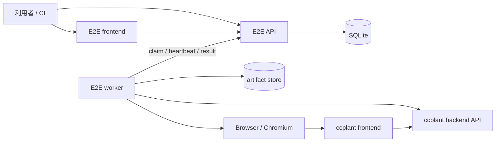

# E2E 実行基盤設計

## 目的

ルートの `e2e/` 以下に、ccplant の実サービスをブラックボックスで検証する独立した E2E
実行基盤を置く。利用者は Web UI または API から Go で実装されたシナリオを選択して実行し、
進捗、ログ、失敗理由、スクリーンショットなどの成果物を確認できる。

既存の `frontend/e2e` は、モックを使ったフロントエンド単体の Playwright テストとして残す。
新しい基盤は backend、frontend、Agent session をまたぐ実環境の検証を担当する。

## 設計方針

- シナリオ、API、worker の主要部分は Go で実装する。操作 UI のみ TypeScript/React とする。
- API と worker を分離し、ローカル、CI、将来の共有検証環境で同じプロトコルを使う。
- worker は登録済みシナリオだけを実行する。API から任意のコマンドや Go コードを渡せないようにする。
- シナリオは外部から見える HTTP/SSE/ブラウザ操作を使い、backend や frontend の内部 package を import しない。
- 最初は SQLite とローカルファイルで完結させ、インターフェースを保ったまま外部 DB と object storage に移行できるようにする。
- リトライは run 全体ではなく明示的に安全な step に限定する。失敗を隠す自動リトライはしない。

## 全体構成



E2E API は制御プレーン、worker は実行プレーンである。ccplant 本体の backend と frontend に
E2E 専用の endpoint は追加しない。

## ディレクトリ構成

```text
e2e/
├── README.md
├── go.mod
├── compose.yaml                 # SUT + API + worker + E2E frontend + Chromium
├── Makefile
├── cmd/
│   ├── api/main.go
│   └── worker/main.go
├── internal/
│   ├── api/                     # HTTP handler、認証、SSE
│   ├── store/                   # run、event、lease、artifact metadata
│   ├── worker/                  # claim loop、実行、heartbeat、cancel
│   └── artifact/                # filesystem 実装。将来 S3 実装を追加
├── pkg/
│   └── scenario/                # シナリオ SDK。外部公開する型と helper のみ
├── scenarios/
│   ├── registry.go              # ID と実装の静的登録
│   ├── smoke/
│   │   └── health.go
│   ├── session/
│   │   └── create_and_chat.go
│   └── browser/
│       └── create_session.go
├── frontend/                    # E2E 操作用の小さな React/Vite アプリ
│   ├── package.json
│   └── src/
├── migrations/
├── testdata/
├── Dockerfile.api
├── Dockerfile.worker
└── .env.example
```

`e2e` は独立した Go module とする。アプリ本体の module にテスト用依存を混ぜず、worker image
だけにブラウザ操作ライブラリなどを含めるためである。Go のバージョンは `backend/go.mod` と揃える。

## コンポーネント

### E2E API

責務は次に限定する。

- シナリオ一覧の提供
- run の作成、参照、キャンセル
- worker への run の lease
- event、step result、artifact metadata の保存
- UI 向けの SSE 配信

API 自身はシナリオを実行しない。再起動しても queued/running run を復元できるよう、状態はすべて
store に置く。

### Worker

worker は起動時に `worker_id`、build revision、登録済み scenario manifest、capability を API に
通知する。空きがある間だけ run を claim し、各 run を個別プロセスとして実行する。

初期値は worker 1 台につき同時実行数 1 とする。ブラウザ状態やテスト対象データの競合を避け、
並列安全性が確認できたシナリオだけ `concurrency_key` を分けて並列化する。

lease の既定値は 30 秒、heartbeat は 10 秒間隔とする。lease が失効した run はすぐに再実行せず
`infra_error` にする。副作用済みか判断できないためである。利用者が明示的に再実行する。

worker は SIGTERM 時に新規 claim を停止し、実行中 run を grace period 内で終了する。キャンセル時は
scenario の context を cancel し、子プロセスを終了した後も teardown と artifact upload を試みる。

### E2E frontend

最初の UI は以下の 3 画面だけにする。

- Run list: 状態、シナリオ、対象環境、開始時刻、所要時間
- New run: シナリオ、許可された parameter、対象 environment の選択
- Run detail: step timeline、追従ログ、artifact、cancel/re-run

UI は API の OpenAPI から生成した client を利用する。run detail の更新は SSE、変更操作は REST とし、
WebSocket は導入しない。

### Scenario SDK

シナリオは `testing.T` へ依存させず、worker から呼び出せる小さな interface にする。

```go
type Definition struct {
    ID              string
    Description     string
    Tags            []string
    Timeout         time.Duration
    Parameters      []Parameter
    Capabilities    []Capability
    ConcurrencyKey  string
    Run             func(context.Context, *Env) error
}

type Env struct {
    Target   Target
    HTTP     *http.Client
    Browser  Browser
    Artifacts ArtifactWriter
    Secrets  SecretReader
}

func Step(ctx context.Context, name string, fn func(context.Context) error) error
func Eventually(ctx context.Context, policy RetryPolicy, check func(context.Context) error) error
```

`Step` は開始、成功、失敗と時間を event として記録し、panic を失敗へ変換する。`Eventually` は
read-only な状態確認用であり、POST などの副作用操作には原則使用しない。

シナリオは package の `init()` に依存せず、`scenarios/registry.go` で明示的に登録する。重複 ID や
不正な parameter schema は worker/API の起動時に検証する。

例:

```go
func Definition() scenario.Definition {
    return scenario.Definition{
        ID:      "session.create-and-chat",
        Timeout: 3 * time.Minute,
        Capabilities: []scenario.Capability{scenario.AgentCredential},
        Run: func(ctx context.Context, env *scenario.Env) error {
            var sessionID string
            if err := scenario.Step(ctx, "create session", func(ctx context.Context) error {
                var err error
                sessionID, err = createSession(ctx, env.HTTP, env.Target.APIURL)
                return err
            }); err != nil {
                return err
            }
            defer deleteSession(context.WithoutCancel(ctx), env.HTTP, sessionID)

            return scenario.Step(ctx, "send and receive message", func(ctx context.Context) error {
                return assertReply(ctx, env, sessionID)
            })
        },
    }
}
```

## API 契約

公開 API は `/api/v1`、worker API は `/internal/v1` に分ける。

| Method | Path | 用途 |
| --- | --- | --- |
| `GET` | `/api/v1/scenarios` | 実行可能なシナリオと parameter schema |
| `POST` | `/api/v1/runs` | run を queued で作成 |
| `GET` | `/api/v1/runs` | run 一覧 |
| `GET` | `/api/v1/runs/{id}` | run、step、artifact の snapshot |
| `POST` | `/api/v1/runs/{id}/cancel` | キャンセル要求。冪等 |
| `POST` | `/api/v1/runs/{id}/rerun` | 元の入力から新しい run を作成 |
| `GET` | `/api/v1/runs/{id}/events` | `id:` 付き SSE。`Last-Event-ID` 対応 |
| `GET` | `/api/v1/runs/{id}/artifacts/{artifact_id}` | artifact download |
| `POST` | `/internal/v1/workers/register` | worker manifest 登録 |
| `POST` | `/internal/v1/runs/claim` | capability に合う run を lease |
| `POST` | `/internal/v1/runs/{id}/heartbeat` | lease 更新、cancel 状態取得 |
| `POST` | `/internal/v1/runs/{id}/events` | event の batch 追記 |
| `POST` | `/internal/v1/runs/{id}/complete` | terminal result 登録。冪等 |

`POST /api/v1/runs` の概略:

```json
{
  "scenario_id": "session.create-and-chat",
  "environment": "local",
  "parameters": {"repository": "ccplant/ccplant"}
}
```

scenario ID は API が把握する manifest に存在するものだけ受け付け、parameter は scenario ごとの
JSON Schema で検証する。target URL や secret を自由入力にせず、管理者が設定した environment ID に
解決する。これにより SSRF と secret の持ち出しを防ぐ。

API 仕様は `e2e/openapi.yaml` を正とし、Go handler の contract test と frontend client 生成に使う。

## Run の状態遷移

```text
queued -> running -> passed
                  -> failed
                  -> infra_error
                  -> cancelled
queued -----------> cancelled
```

- `failed`: シナリオの assertion が満たされない。
- `infra_error`: worker 消失、browser 起動失敗、artifact store 障害など、対象機能の成否を判定できない。
- `cancelled`: queued 中または実行中に利用者が取り消した。

terminal state から状態は変えない。再実行は同じ run の巻き戻しではなく、新 run を作り
`rerun_of` で関連付ける。

run と event の主キーは ULID とする。event は run ごとの単調増加 sequence を持ち、SSE の
`Last-Event-ID` と worker の batch retry の重複排除に使う。

## ブラウザ操作

Go から Chrome DevTools Protocol を操作できる `chromedp` を第一候補とする。Chromium は worker
image に同居させず、compose 上の browser service または CI の service container として起動し、
remote debugging endpoint へ接続する。これにより worker image と browser version の責務を分離する。

各 browser scenario は独立した browser context を使い、終了時に破棄する。失敗時には最低限、
スクリーンショット、現在 URL、DOM snapshot、browser console を保存する。trace/video は容量が大きい
ため、初期実装では opt-in とする。

セレクタは表示文言や CSS class ではなく `data-testid` と role を優先する。E2E 用の安定した識別子を
プロダクション UI に置くことは許容するが、E2E 専用分岐は置かない。

## データ、artifact、secret

初期実装の SQLite table は `runs`、`run_events`、`artifacts`、`workers`、`scenario_manifests` とする。
log も event として保存するが、1 event の上限と run 全体の上限を設ける。

artifact は `run_id/artifact_id/name` の固定規則で保存し、利用者指定パスを連結しない。metadata には
SHA-256、content type、size を持たせる。保持期間は既定 7 日、失敗 run は 14 日とし、後続の GC で
削除する。

secret は API の DB、run parameter、event、artifact に保存しない。worker に環境変数または
secret mount で渡し、scenario からは論理名で参照する。logger は既知 secret を redact するが、
redaction だけに依存せずシナリオ側で値を出力しない。

## ローカル実行

```bash
make e2e-up
make e2e-smoke
make e2e-down
```

`make e2e-up` は root の compose を置き換えず、`docker compose -f compose.yaml -f e2e/compose.yaml`
で ccplant backend/frontend と E2E 基盤を同じ network に起動する。host port は E2E frontend 3001、
E2E API 8081 を既定とし、SUT は既存の 3000/8080 を維持する。

`make e2e-smoke` は API に run を登録し、polling で terminal state を待って、その exit code を返す
薄い Go CLI を使う。CI が UI の内部構造に依存しないようにする。

## CI

段階的に次の job を追加する。

1. `e2e-unit`: API/store/worker/SDK の unit test、race test、frontend type-check/test。
2. `e2e-smoke`: compose を起動し、health と認証なしの基本導線を実行。全 PR で必須。
3. `e2e-agent`: 実 provider credential が必要なシナリオ。fork 以外の main push または手動実行。

CI では run 完了の成否にかかわらず API DB、worker log、artifact を GitHub Actions artifact として
upload する。シナリオ自体の retry は無効にし、flaky test を可視化する。job timeout は scenario
timeout より長くするが、上限を設ける。

path filter には `e2e/**` に加え、E2E が対象とする `backend/**` と `frontend/**` を含める。

## テスト戦略

- SDK: step の event 順序、panic/error/cancel/timeout、redaction を unit test。
- Store: lease の排他、期限切れ、event sequence、complete の冪等性を SQLite で test。
- API: `openapi.yaml` と status code/body の contract test。
- Worker: fake API と fake scenario で claim、heartbeat、cancel、異常終了を test。
- System: compose 上で `smoke.health` を投入し、UI を介さず run が passed になることを test。
- UI: mock API による component test と、E2E API まで含む最小の browser test。

E2E 基盤自身のテストと、ccplant の E2E シナリオを分離する。前者が壊れた場合は `infra_error` と
`failed` を混同しない。

## 実装順序

### Phase 1: 最小実行ループ

- Go module、scenario SDK、静的 registry
- SQLite store、run 作成/取得、claim/heartbeat/complete
- worker と API-only の `smoke.health`
- compose、CLI、unit/system test

この時点で CI から Go シナリオを安定して実行できる。

### Phase 2: 観測性と UI

- event batch、SSE、artifact store
- run list/new/detail の E2E frontend
- cancel、rerun、失敗時 artifact

### Phase 3: 実ユーザーフロー

- remote Chromium と browser SDK
- セッション作成、チャット、削除の API/browser シナリオ
- credential capability、CI の protected job

### Phase 4: 共有環境対応

- API/worker 認証、worker pool、retention GC
- 必要になった時点で PostgreSQL と S3-compatible storage を追加
- OpenTelemetry と run/trace の関連付け

## 受け入れ条件

- `e2e/` だけで API、worker、E2E frontend、scenario の責務を追える。
- シナリオ追加は Go package の追加と registry への 1 行の明示登録で完結する。
- ローカルで 1 コマンド起動でき、CLI と UI のどちらからも同じ run を開始できる。
- worker が落ちても run が永続化され、`infra_error` として確定できる。
- run の各 step、ログ、失敗 artifact を UI と API から参照できる。
- API 経由で任意コマンド、任意 URL、未定義 parameter を実行できない。
- CI 失敗時にログと artifact が残り、ローカルで同じ scenario ID を再現できる。

## 今回採用しない案

- **Go の `_test.go` をそのまま worker から起動する**: 一覧、parameter schema、step event、cancel の
  制御が弱くなるため、scenario interface を採用する。ただし SDK 自体の検証には `go test` を使う。
- **API が Docker socket を操作して SUT を毎回構築する**: 権限が強すぎ、CI/Kubernetes で移植しにくい。
  SUT の lifecycle は compose または CI workflow、API は run lifecycle のみ担当する。
- **最初から Kubernetes Job を run ごとに作る**: MVP として運用負荷が大きい。lease protocol を先に
  固めれば、将来 worker 実装を Job launcher に差し替えられる。
- **既存 `frontend/e2e` の置換**: モック中心の高速な回帰テストとは目的と実行時間が異なるため共存させる。
